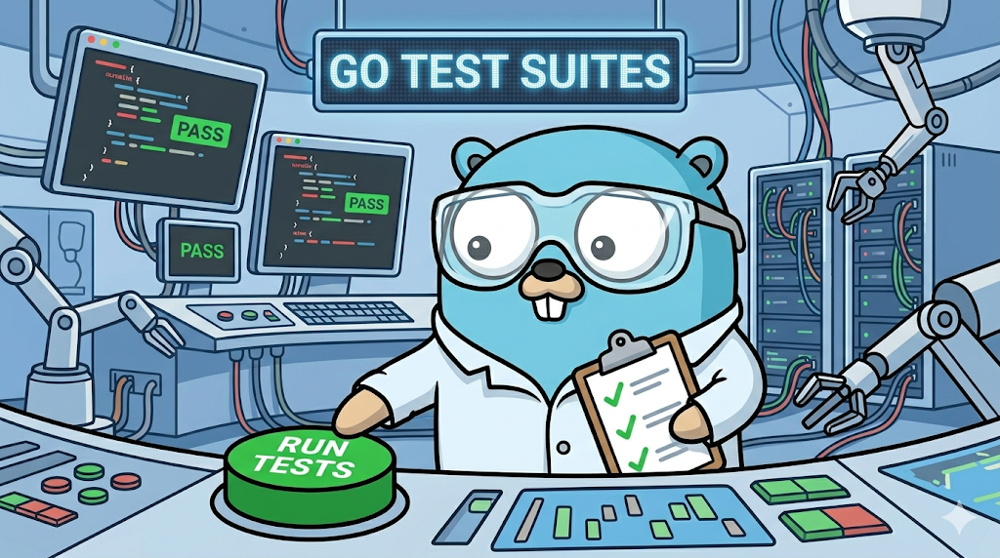

# Go - Test Suites

<p align="center">
  
</p>

Specification-driven test suites for Go.

[gotest](https://github.com/mvrahden/go-test) generates standard `go test` code from struct-based suites — BDD organization, lifecycle hooks, and structured output. No reflection, no runtime deps.
This extension brings that into VS Code: run, debug, watch, and verify your suites without leaving the editor.

## Why this extension?

Test Explorer shows your suites as **Package > Suite > Method > Subtest** — not a flat list of functions.
Run or debug at any level. Coverage gutters track implementation progress. Watch mode streams results as you code.

The **Spec View** renders your test structure as a behavioral specification — a readable tree with pass/fail indicators, go-to-source navigation, and clipboard export. Your tests become documentation regenerated from every run.

**AI-assisted workflows** — Paste specs into AI conversations as context. The clean exports feed well into LLM toolchains. You define what the system should do — the tests verify.

- **Spec View** — Your quality dashboard. BDD-formatted specification tree with pass/fail/skip indicators, go-to-source navigation, and structured clipboard export.
- **Suite-aware Test Explorer** — Navigate tests as Package > Suite > Method > Subtest, not a flat list of functions.
- **Coverage gutters** — Track implementation progress with native VS Code coverage integration, per-statement highlighting, and persistent results across sessions.
- **One-click Run and Debug** — CodeLens buttons above every suite and method. Debug with Delve, breakpoints included.
- **Watch mode** — Continuous verification on file changes with streaming results and a status bar indicator.
- **Focus/Exclude management** — Toggle `F_`/`X_` prefixes via Quick Fix actions. Diagnostic warnings prevent focused tests from reaching CI.
- **Scaffold generation** — Generate test suite skeletons from types and files via code actions or the command palette.

## Getting started

### Prerequisites

- **Go** (1.25+)
- **VS Code** (1.123+)
- **[Delve](https://github.com/go-delve/delve)** (for debugging only)

The extension invokes the gotest CLI automatically — no separate install needed.
It runs the CLI your `go.mod` selects: `go tool` when the tool directive is declared, otherwise `go run` at the pinned version.
The CLI must be **v1.39.0 or newer**; the Spec View's **Change** scope needs **v1.42.0**, and with an older CLI it says so and leaves the rest of the extension as it is. A release candidate or a commit before that release (`v1.39.0-rc.1`, `v1.38.1-0.<time>-<commit>`) is older than it; a commit after it (`v1.39.1-0.<time>-<commit>`) is newer. A binary or a `go.mod` pin is checked at activation; a CLI reached through `go run` or `go tool` is checked from the `version` that opens every document it writes, so an older one is refused at discovery rather than trusted.

### Install

Search **"gotest"** in the Extensions panel, or install from the command line:

```
code --install-extension mvrahden.gotest
```

Also available on [Open VSX](https://open-vsx.org/extension/mvrahden/gotest) for VS Code forks.

### First run

1. Open a Go project that uses [gotest](https://github.com/mvrahden/go-test) suites.
2. The extension discovers test suites automatically on activation.
3. Open the **Testing** sidebar to see your suites organized by package.
4. Click the **Run** or **Debug** button next to any suite or method.

The extension works in a workspace folder only when a go.mod there uses gotest: the module is gotest itself, or it declares the CLI as a tool, replaces the module, or requires it directly (a require marked `// indirect` alone does not count). With a go.work in the folder, its use modules are read instead of the folder's go.mod, and one such module is enough. Elsewhere the extension discovers nothing, runs no CLI, writes no git setting and shows no Spec View button.
A change to go.mod or go.work is followed within a second: the CLI is resolved again and the folder rediscovered, so an upgrade, a new tool directive or a first require shows without a reload.

## Features

### Test Explorer

Tests appear in a structured tree: **Package > Suite > Method > Subtest**.
Run or debug at any level — a single method, an entire suite, or all tests in a package.
Multi-select is fully supported.
Test results persist across sessions, so you see pass/fail state immediately after reopening the editor.
The tree itself is restored from disk on startup, so suites are browsable straight away instead of waiting for the Go toolchain to finish discovery.
A run the CLI failed is never green: when it exits non-zero and no test or package carries a failing verdict, the packages (for a fuzz or bench run, the selected targets) are marked errored with what the CLI said and its exit code.
A test that started and got no verdict because its process died — a test timeout, a panic on a goroutine — is marked errored with what it printed, and its package's message names it. The Spec View shows such a test as NOT RUN until the CLI reports it otherwise.
When a Go file of a package changes, the verdicts shown for that package are marked outdated (VS Code dims them) until it runs again. Packages that import the changed one are not marked here: the extension does not know the import graph. The Spec View asks the CLI instead, which does (see *Stale verdicts* below).
The **Run Changed** profile (and **Go Test: Run Changed Packages**) runs `gotest --changed` in a folder: only the packages whose inputs changed since the last run record, and those that failed or never ran. Its run is named *changed packages only*, its output says how many packages it ran and how many it left out, and a package it left out keeps the verdict it had; it is not a full run.

### CodeLens

**Run** and **Debug** buttons appear inline above every suite and test method in `_test.go` files.
Click to execute immediately.
An **↻ Update Snapshots** lens additionally appears above methods that call `MatchSnapshot` (and their suite), re-running them with `--update-snapshots`.
Benchmark methods get **Bench**, **5×**, and a persistent result annotation (see [Benchmarks](#benchmarks)); fuzz methods get **Fuzz** and **Debug Seeds** (see [Fuzzing](#fuzzing)).

Package-level and file-level actions appear on the `package` declaration line:

- **Run Package** — run all suites in the package
- **Run File** — run all suites defined in the current file (shown when the file contains multiple suites)

### Coverage

Use the **Coverage** run profile in Test Explorer to run tests with `go test -coverprofile`.
Results appear as native VS Code coverage gutters.
Coverage data persists across sessions and accumulates across packages.
Source file edits automatically invalidate stale coverage for the affected package.

Copy a tabular coverage summary to the clipboard via the **Go Test: Copy Coverage Summary** command.

### Watch mode

Start continuous testing with **Go Test: Start Watch**.
The extension spawns a `gotest watch` process that re-runs tests on file changes.
Results stream into Test Explorer in real-time; each cycle's run ends, and the Spec View refreshes, when the CLI reports the cycle over.
A watch cycle the CLI failed for a reason no test carries (a shared fixture that did not tear down) marks the packages the cycle reported as errored and says why in the run's output; a watch process that dies during a cycle ends that cycle the same way.
A status bar item shows active watcher count and lets you stop all watchers with a click.

### Spec View

After each test run, the **Spec View** panel renders BDD-formatted output with color-coded pass/fail/skip indicators.
Open it with **Go Test: Show Spec View**.

- **The newest verdict of everything that ran** — every package the panel has seen stays, each test with the verdict of the newest run that reported it, whichever of a run, a coverage run or a watch cycle that was; rerunning one method leaves its siblings as they were
- **When each package last ran** — each package shows when it last ran (last run 14:32, with the date when it was not today): the time the newest run that reported the package finished. A rerun of one method moves the package's time; the other rows keep the verdicts of their own, older runs. An imported events file shows no time
- **Rows that are gone** — a suite or method that was deleted or renamed leaves the panel at the next discovery of its package; before, its last verdict stayed until the whole package ran again. Rows below a method (behaviors, table rows) follow their method's next run
- **The specification under the runs** — the CLI lays a folder's runs over what the folder's source declares (`gotest spec --declared`), so a behavior no run reported is listed as *not run*, and every package and module row carries the CLI's counts
- **Before the first run** — a folder nothing ran in shows what its source declares, every row *not run* and each package marked *declared, not run yet*
- **What the CLI says of a row** — a skip's reason, a row whose behaviors are known only at run time (*INCOMPLETE*), a leaf that passed without an assertion (*VACUOUS*), one that asserts by other means (*ASSERTS BY*) and how many assertions a leaf made when the run counted them; the trailer counts the vacuous, the other-means and the excluded leaves
- **Which run it shows** — a line under the toolbar names the run's commit, whether the tree had uncommitted changes, the agent that ran it and its exit code, and for a `--changed` run how many packages it ran and left out; each named `ExclusiveGroup` is listed with its suites and wall time
- **Stale verdicts** — after a render, and once a burst of edits to Go files, `go.mod`/`go.work` or testdata settles, the panel asks the folder's CLI which of the shown packages' verdicts still belong to the tree (`gotest spec --check-fresh`, which compares each package's input hash with the run's, importers included). A stale package is dimmed under *stale: inputs changed since the run*, and a line under the toolbar counts them; a package whose run stamped no hash is *unknown*, said only in its tooltip. One check per folder per burst, a newer one stopping the one it supersedes; a CLI without run records (before v1.42.0) marks nothing
- **Run changed** — the toolbar's **Run changed** runs `--changed` in the active folder, as the Run Changed profile does
- **A branch's own verdict** — a suite whose hooks failed is red, and what it printed (a failed `AfterAll`, a panic booked on the suite) is shown on it
- **Go-to-source** — click any suite, method, fuzz target, When or It the source declares to navigate to the line the CLI names; `file:line` in failure output opens that line
- **Run, Debug, Rerun failed** — hover a row to run or debug it; a behavior the Test Explorer does not list runs as its method
- **Toolbar** — expand/collapse all, show or hide passed, failed, skipped and not run rows (the CLI's `--hide`; the counts stay the run's), search behaviors by name
- **Copy / Clear** — copy what the panel shows as the CLI's Markdown, or clear results
- **Persistence** — the panel survives editor reload and restores what it kept
- **A render that failed** — when a render fails the panel keeps the last picture and says so at its top, with the reason and a Retry button; the next successful render removes the notice
- **Live updates** — refreshes from test runs, coverage runs and watch mode, rendered when the panel is visible; with `gotest.specView.autoRefresh` off, runs are kept and shown on **Refresh**
- **Scopes** — **Spec**, **Change** and **Runs** switch at the panel's top; the panel reopens in the scope it was left in
- **Saved runs** — **Go Test: Open Events File…** opens a `--events-file` stream (or any `go test -json` capture) as a source of its own beside the workspace's runs, and replays it into the Test Explorer as a run named `Imported: <file>`; packages the workspace does not hold are listed once

### Change scope

The panel's **Change** scope (or **Go Test: Show Change View**) is the audit of a change: what the working tree did to the tests against a base, as `gotest audit --base=<ref> --format=json` reports it. The extension renders the document and judges nothing itself; the terminal (`gotest audit`) and a pull request (`--format=md`) show the same facts.

- **The base** — by default the merge-base of `HEAD` with the remote default branch (`origin/HEAD`, else a remote's `main` or `master`). **Base:** picks another: the merge-base again, a branch or tag, or any ref typed in; the choice is kept per folder. The extension passes the ref; the CLI records the base tree itself. A folder outside git says so, and one with no default branch asks for a base
- **Head and counts** — the branch, the head commit and whether it has uncommitted changes, the base's ref and commit, and the document's counts: with evidence also failing, not run, vacuous and stale, with coverage the unproven lines and the files without coverage data
- **Evidence** — the runs that judged the change, each current or stale with the CLI's reason, its commit, exit code and agent. Every weakening and behavior carries its verdict as the CLI's text marks it (`pass 1`, `FAIL`, `vacuous`, `partly run`, `not run`, `no evidence`, `skip`, `*` for a stale run); hovering a mark names the run it came from and what the other runs said
- **Audit with a run** — runs `gotest audit --base=<ref> --run --format=json`: the CLI runs the packages of the changed behaviors, with coverage of the changed production packages, and takes that run as current evidence. It runs until it ends or **Cancel** stops it, the run's fixtures torn down as a stop of any run is; **Refresh** stays the fast audit from source alone
- **Evidence from runs** — runs chosen in the Runs scope (**Use as evidence**) are passed to every audit as `--evidence=<events file>`, and show as chips under the toolbar; × drops one, and one whose file is gone is marked and not passed. Whether such a run is current the CLI decides, by input hash
- **Needs a decision** — every weakening the audit lists, in its order (removed, excluded, focused, guarded, budget, suppression, snapshot, assertions, asserts-by), then the evidence rows the document says need a decision, grouped by their mark. Each weakening opens the diff of its file against the base (**Open diff**): the base's lines on the left, the head's on the right, a removed one on the base's side; each evidence row opens where the head declares its behavior (**Open**); runs its test by the package and `-run` pattern the document names (**Run**), never one the head no longer has; and can be **Accept**ed. A group with more than five rows is folded behind its count
- **Accept** — a note for yourself, kept per finding id: in the workspace's state, never sent anywhere, and forgotten when the head commit changes. Accepted rows move to the bottom; the band's head counts open and accepted
- **Changed behaviors** — added, removed, reworded, moved and changed, by package and suite, each with its mark and **Run**; a row opens where the behavior is declared, a removed one in the base's copy of its file
- **Unproven lines** — per changed production file the changed lines no test executed, as ranges; each range opens the file at its lines. A file of a package no profile covers reads as no coverage data
- **Information, not compared, notes** — the document's other lists, when it has them
- **Refresh** — on the button, and after a run in the folder while the scope is on show. One audit of a folder runs at a time, a busy notice shows while it does, and closing the panel stops it. An audit that exits non-zero with a document (a package it could not read) still renders, with its exit code; one without a document shows what the CLI wrote on stderr
- **An older CLI** — before it audits, the scope asks the folder's CLI what it can do (`gotest version --json`): it audits when the CLI lists `audit` and writes an audit schema the extension reads, a pre-release build included. A CLI that predates `--json` gets the version it named and the `go get` that upgrades to v1.42.0, with **Upgrade** when `go.mod` pins the CLI; one that writes a newer schema asks for a newer extension

### Runs scope

The panel's **Runs** scope lists the folder's run records, newest first, as `gotest runs --format=json` prints them. Every gotest run leaves one, from a terminal, an agent or this editor alike; the editor's own runs save their stream with `--events-file` under the extension's storage (the newest 50, none older than 30 days, as the CLI keeps its records), so they can be opened and used as evidence too.

- **Each run** — its time, PASS or FAIL with the exit code, the agent it ran under (or none), its commit and whether the tree was dirty, the command, the tests' counts, *narrowed* for a `--changed` run with how many packages it ran and left out, *imported* for one imported from a file, and what it says of the tree now: *judges this tree: n current / n stale / n unknown*, as the CLI hashes the packages now
- **Open in Spec** — renders the run's events file in the Spec scope, as a source of its own
- **Use as evidence** — toggles the run as evidence for the Change scope's audits; the choice is kept per folder in the workspace's state
- **Import run…** — picks an events file (a CI run you downloaded) and keeps its run among the folder's records (`gotest runs --import`)
- **Run changed** — runs `--changed` in the folder
- **An older CLI** — one without `runs` (before v1.42.0) gets the `go get` that upgrades it, with **Upgrade** when `go.mod` pins the CLI

### Sessions

A **gotest Sessions** view in the Testing sidebar lists the CLI sessions running now, per folder: test and coverage runs, `--changed` runs, watchers, bench and fuzz sessions from the Test Explorer, audits and the `prepare` behind a debug session, each with what it runs and when it started. **Stop** on a row stops that session alone, the way its own cancel does: a run gets its stop and its fixtures' teardown, then force after `gotest.forceKillTimeout`. The view is hidden while nothing runs.

### Language model tool

The extension contributes the `gotest_audit` tool (`#gotestAudit` in chat) to agents in the editor. It returns the active folder's audit as `gotest audit --format=md` writes it, so an agent reads the document the Change scope shows, through the same one audit per folder. Its input: `base`, a ref to audit against (the folder's chosen base when left out), and `run`, which runs the tests of the changed behaviors as evidence and asks you to confirm first. A CLI without `audit` gets a plain explanation of the release it needs. The tool needs VS Code's language model tools API; an editor without it goes without the tool.

### Lint

Saving a `_test.go` file runs `gotest lint -json` on its package and shows the findings as problems over the code each is about, with the rule as their code: an integrity rule's finding is an error, any other a warning, as `gotest lint -rules -json` tiers them. A finding the CLI can fix offers its fix as a Quick Fix; when the file changed since the lint read it, the fix lints again first. **Go Test: Fix lint findings in package** applies every fix through `gotest lint -fix`, and **Go Test: Lint Workspace** lints each folder. Which rules run is `.gotest.yml`'s `lint.skip`, read by the CLI itself.

### Focus and Exclude

Place your cursor on a suite or method definition and use the **Quick Fix** menu (Ctrl+. / Cmd+.) to:

- **Focus** a test (`F_` prefix) — only focused tests run
- **Exclude** a test (`X_` prefix) — test is skipped
- **Unfocus / Include** — remove the prefix

A status bar warning and inline diagnostics alert you when focused tests exist, preventing CI failures from `gotest --ci`.

### Benchmarks

A benchmark answers with a number, and a number is meaningless in isolation.
Every surface here exists to close the loop between "I changed this code" and
"what happened to the number" — powered by `gotest bench --json`; all
statistics (Welch's t-test significance, deltas, the gate rule) are computed
by the CLI, never re-derived in the extension:

- **▶ Bench** CodeLens on every `Benchmark*` method — runs exactly that
  method (go test's sub-benchmark scoping). **▶ Bench Suite** on the suite
  runs them all; **5×** runs with `-count=5` for a trustworthy mean ± spread.
- **Result annotations** — the last measured numbers render right above the
  method (`1.24µs/op · 480 B/op · 3 allocs/op — 2m ago`) and survive editor
  reloads. Results are keyed per goos/goarch: a number measured on another
  platform is a different number and is never shown on this host.
- **Trend on hover** — hovering a benchmark shows its run-over-run sparkline
  with the endpoints spelled out, from a bounded local history (last 50 runs).
- **Baselines** — *Go Test: Save Bench Baseline* and *Go Test: Compare vs
  Baseline* wrap `--save`/`--against`, defaulting to `bench.baseline` from
  `.gotest.yml`. After a compare, significant deltas render inline
  (`+12.3% vs baseline`); deltas the CLI did not mark significant display
  nothing — the UI never dresses up noise.
- **Gate warnings** — when `bench.gate` is configured and a run breaches it,
  the offending methods get warning diagnostics at their definitions.
- **Test Explorer** — benchmarks appear under their suites with a dedicated
  **Bench** run profile. They never run as part of a normal test run: timing
  numbers taken while tests hammer the machine are noise.
- **Profiling** — *Go Test: Profile Benchmark (CPU/Mem)* runs one benchmark
  with `-cpuprofile`/`-memprofile` and opens `go tool pprof -http` on the
  result.

Benchmarks are deliberate acts: there is no bench-on-save and watch mode
never benchmarks.
Cancelling a bench run stops the CLI through its stdin, as a test run is
stopped; a cancelled run records no numbers.
A benchmark that fails is failed on its item with what it printed. A bench
run that exits non-zero for another reason — a suite's teardown, a gate with
nothing to compare — marks the selected benchmarks errored with the CLI's
words; a breached gate is shown by its diagnostics and leaves the benchmarks
passed.

### Fuzzing

Fuzz methods on suites get their own surfaces, built on the `gotest fuzz` CLI and its exit contract:

- **Fuzz run profile** in the Test Explorer's run dropdown, beside Bench — offered where fuzz targets are selected, it searches every selected target for the `gotest.fuzz.for` budget (the CLI's minute by default): one session per package when all of its targets are selected, one per target otherwise. A target passes with the session line, fails with its new crasher files named, and a cancelled search is skipped, not failed; a session that ends non-zero without a crasher or a failing seed (the CLI could not be built, was killed, refused its arguments) marks its targets errored with the CLI's words. Targets a cancel never reached are skipped.
- **▶ Run** CodeLens on every `Fuzz*` method replays its seeds as an ordinary test run, like a test method's Run.
- **▶ Fuzz** CodeLens on every `Fuzz*` method — pick a budget (30s, 5m, 30m, until stopped, or any Go duration) and the target fuzzes in a cancellable background session with live `execs/sec` progress. Nothing found ends quietly; time exhaustion is not a failure.
- **Crasher notifications** — when the session finds a new crasher, choose **Show Decoded Input** (triage prints the typed Go literal, not corpus bytes), **Promote to Seed** (splices a typed `f.Add(...)` into the fuzz method and reveals the edit), or **Debug Crasher** (replays exactly that corpus entry under the debugger, suite lifecycle included).
- **⚠ Promote N crashers** CodeLens — the crashers the latest fuzz session wrote surface right on the target until promoted; older corpus files are not counted, since promote leaves them in place.
- **Debug Seeds** CodeLens — replay a target's whole seed corpus under the debugger.
- **Test Explorer and Spec View** — fuzz targets appear under their suite in both, the Spec View as a property row beside the suite's examples, marked `FUZZ` with its seed count and counted as fuzz targets in the trailer; running one replays its seeds as ordinary subtests. Searching for *new* inputs is deliberate: the Fuzz run profile or a **▶ Fuzz** CodeLens, never a side effect of an ordinary test run, because fuzzing burns CPU on demand.
- **Suite runs replay seeds** — running a whole suite from the explorer includes its fuzz-seed replay, matching what `gotest ./...` does on the CLI.

Watch mode deliberately never fuzzes: watch is fast, deterministic feedback; fuzzing is a budgeted stochastic search.

### Scaffold

Generate test suite skeletons from existing code:

- **Code action on a type declaration** — "Generate test suite for TypeName"
- **Code action on any Go file** — "Generate test suite for this file"
- **Command palette** — "Go Test: Scaffold Suite" for manual target entry

The generated file opens automatically and discovery refreshes.
The "Generate test suite for …" code actions are offered only in a folder that uses gotest; the palette command works everywhere.

### Copilot Chat skill

The extension ships the `writing-gotest-tests` [agent skill](https://github.com/mvrahden/go-test/tree/main/skills/writing-gotest-tests) to Copilot Chat in workspaces where gotest is active.
Copilot loads it when a chat request is about writing, fixing or migrating gotest suites, so the agent follows gotest's lifecycle, assertion and CLI rules instead of stdlib or testify habits.

### Multi-root workspaces

Fully supported.
Each workspace folder is discovered independently.
Commands resolve the correct workspace folder from the active editor, and file watchers trigger per-folder discovery.
Per-project settings like `cliPath`, `testFlags`, and `buildTags` can be configured per folder via `.vscode/settings.json`.
Projects using `go.work` are also supported.

## Commands

The palette offers these. Commands that act on one test, benchmark or fuzz target (Run, Debug, Run File, Fuzz Target, …) need that target and are reached through CodeLens, the Test Explorer and code actions.

| Command | Description |
|---------|-------------|
| Go Test: Refresh | Re-run test discovery for all workspace folders |
| Go Test: Show Focused Tests | List all focused tests and navigate to them |
| Go Test: Show Spec View | Open the BDD spec output panel |
| Go Test: Show Change View | Open the panel's Change scope: the audit of the working tree against its base |
| Go Test: Run Changed Packages | Run `--changed` in the active folder: only the packages whose inputs changed since the last run record |
| Go Test: Open Events File… | Open a saved `go test -json` stream in the Spec View and the Test Explorer |
| Go Test: Fix lint findings in package | Apply every suggested lint fix in a package and show what is left |
| Go Test: Lint Workspace | Run `gotest lint` on every workspace folder |
| Go Test: Start Watch | Start continuous testing for a package scope |
| Go Test: Stop Watch | Stop all active watch processes |
| Go Test: Save Bench Baseline | Save the workspace's benchmark results as a baseline |
| Go Test: Compare vs Baseline | Compare current numbers against a saved baseline |
| Go Test: Profile Benchmark (CPU/Mem) | Profile one benchmark and open `go tool pprof` |
| Go Test: Scaffold Suite | Generate a test suite from a target |
| Go Test: Update Snapshots | Re-run tests with `--update-snapshots` to rewrite `MatchSnapshot` baselines (also a run profile and a CodeLens on snapshot tests) |
| Go Test: Copy Coverage Summary | Copy coverage table to clipboard |
| Go Test: Copy Test Results | Copy test results to clipboard (also available as context menu on test items) |
| Go Test: Clear Results | Forget stored results, coverage and spec output, so a window reload does not restore them. The Test Explorer's own "Clear all results" only empties VS Code's in-memory view; clearing the icons in the tree is still its job, because no stable API lets an extension retract them. |

## Settings

### Per-project settings (resource scope)

These can be set in `.vscode/settings.json` per workspace folder:

| Setting | Default | Description |
|---------|---------|-------------|
| `gotest.cliPath` | `""` | Path to a gotest binary (overrides all other resolution) |
| `gotest.modulePath` | `github.com/mvrahden/go-test/cmd/gotest` | Package path of the gotest CLI |
| `gotest.suggestToolDirective` | `true` | Offer once per folder to declare the pinned CLI as a tool in `go.mod` |
| `gotest.buildTags` | `""` | Comma-separated Go build tags (e.g. `integration,e2e`) |
| `gotest.testFlags` | `[]` | Additional flags passed to gotest (`--` prefixed) and `go test` (`-` prefixed) |
| `gotest.buildFlags` | `[]` | Additional build flags passed to Delve |
| `gotest.discoverOnSave` | `true` | Re-discover tests when `_test.go` files change |
| `gotest.coverOnRun` | `true` | Collect coverage data alongside normal test runs |
| `gotest.coverOnSave` | `false` | Re-run package coverage when a `.go` file is saved |
| `gotest.lintOnSave` | `true` | Lint the package of a saved `_test.go` file and show its findings as problems |
| `gotest.coverTestOnlyPackages` | `false` | Enable cross-package coverage instrumentation for test-only packages |
| `gotest.debug.prepareTimeout` | `60` | Seconds to wait for debug preparation before timing out |
| `gotest.discoveryTimeout` | `120` | Seconds to wait for test discovery before giving up (raise it for a very large workspace) |
| `gotest.forceKillTimeout` | `360` | Seconds a cancelled run, watch or debug session gets to tear down. Cancelling writes `stop` to the CLI's standard input (it runs with `--control=stdin`, so the stop is graceful on Windows too), which starts the fixtures' teardown, and the CLI allows that up to 5m30s, so this must outlast it. At the timeout the CLI is sent `force`, a second Ctrl-C that releases the fixtures at once, and what still runs five seconds later is killed |
| `gotest.fuzz.for` | `""` | Budget for fuzz sessions started from the Test Explorer's Fuzz profile (a Go duration; empty uses the CLI's default of one minute) |
| `gotest.watch.scope` | `./...` | Default package scope for watch mode |

### Global settings (window scope)

| Setting | Default | Description |
|---------|---------|-------------|
| `gotest.showCodeLens` | `true` | Show Run/Debug CodeLens above suites and methods |
| `gotest.showFocusWarnings` | `true` | Show diagnostics for `F_` prefixed (focused) tests |
| `gotest.specView.autoRefresh` | `true` | Render new runs in the Spec View as they finish; when off, they are kept and shown on Refresh |
| `gotest.watch.autoRestart` | `true` | Auto-restart watch process on crash |

### Example `.vscode/settings.json`

```jsonc
{
  // Use a local gotest binary instead of go run
  "gotest.cliPath": "./bin/gotest",

  // Pass build tags to discovery and test runs
  "gotest.buildTags": "integration,e2e",

  // Extra flags for go test (e.g. timeout, verbose)
  "gotest.testFlags": ["-timeout=120s", "-v"],

  // Control parallelism:
  //   --parallel=N  total concurrent tests across all suites (gotest flag)
  //   -parallel=N   concurrent tests within each suite (go test flag)
  // "gotest.testFlags": ["--parallel=12", "-parallel=4"],

  // Extra build flags for Delve debug sessions
  "gotest.buildFlags": ["-gcflags=all=-N -l"]
}
```

### Gotest CLI resolution

The extension runs whatever `go.mod` selects, in this order:

1. **`gotest.cliPath`** — Explicit path to a binary. Highest priority; version-validated against the minimum required version.
2. **Workspace is gotest module** — If the workspace's `go.mod` declares the gotest module itself (development or `go.work` overlap), uses `go run ./cmd/gotest`.
3. **Tool directive** — If `go.mod` declares the CLI as a tool (`go get -tool github.com/mvrahden/go-test/cmd/gotest@<version>`), uses `go tool <modulePath>`.
4. **`go.mod` + replace directive** — If `go.mod` has a `replace` directive for the gotest module, uses `go run modulePath` (no version, respects replace resolution).
5. **`go.mod` pinned version** — If `go.mod` requires gotest at v1.39.0 or newer, uses `go run modulePath@version`, and offers once to declare the tool at that version (`gotest.suggestToolDirective`; never in a vendored module).
6. **Pinned below v1.39.0** — Refused with an **Upgrade** action; a newer CLI generates code the pinned runtime cannot compile. **Upgrade** moves each pinning module to the newest release whose `go` line does not exceed the module's, so the module's Go version stays put. A `go 1.N` line takes a release that needs `go 1.N.0`: the same language version, which `go get` only spells out. When even v1.39.0 needs a newer Go, it changes nothing and names the `go` line required; raising it is your call. The release lookup runs in a private temporary module, so your `go.mod`, a `go.work` and `-mod`/`-modfile` in `GOFLAGS` do not affect it, while proxy settings do; it shows progress and can be cancelled, and releases the proxy cannot serve are skipped. A floor hit while an upgrade runs does not start a second one.
7. **No pin** — When no module requires gotest the extension runs no CLI: there is no version to run, and it never substitutes `@latest`. **Scaffold Suite** then offers to add gotest first (`go get -tool <module>@latest` in the module of the target) and scaffolds once go.mod pins it. A `gotest.modulePath` that carries its own `@version` is run as written.

In a `go.work` root every `use` module is read: a tool declared by any of them counts, and the pin is the highest across modules, which is what the workspace builds.

### Go binary resolution

The extension finds one `go` and leaves the toolchain to Go: `go run` and `go tool` honour the module's `go` directive and pass their own `go` to the CLI.

1. **`GOROOT`** — `$GOROOT/bin/go` if set.
2. **Login shell** — Runs `bash -lc 'command -v go'` to find Go on the user's full PATH.
3. **Common paths** — `/usr/local/go/bin/go`, `~/go/bin/go`, `/usr/bin/go`, `~/sdk/go*/bin/go`.

## Requirements

- VS Code 1.123 or later
- Go 1.26 or later
- A Go project using [gotest](https://github.com/mvrahden/go-test) suites
- [Delve](https://github.com/go-delve/delve) for debug support

## License

MIT
